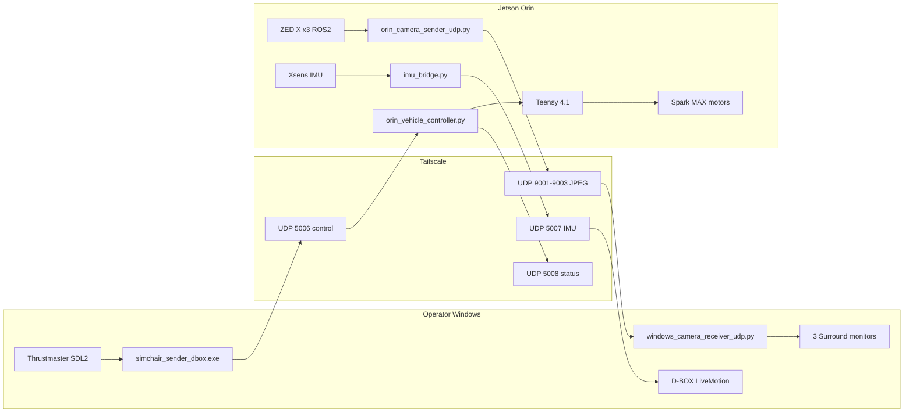

# Technical Architecture: Marvin Sim Chair

**Updated:** 2026-08-07

Three bidirectional channels over Tailscale connect the sim-chair Windows PC to Marvin’s Jetson Orin.



---

## Port map

| Direction | Port | Protocol | Payload |
|-----------|------|----------|---------|
| Windows → Jetson | **5006** | UDP | `steering,throttle,brake,mode` |
| Jetson → Windows | **5007** | UDP | IMU binary @ ~50 Hz |
| Jetson → Windows | **5008** | UDP | Vehicle controller status |
| Jetson → Windows | **9001 / 9002 / 9003** | **UDP** | Chunked JPEG (primary) |
| Jetson → Windows | 9001 / 9002 / 9003 | TCP | JPEG (legacy) |

Primary video: **chunked JPEG over UDP** (~1280×720 @ 30 fps). TCP JPEG and H.264 RTP remain fallbacks.

---

## Control path

```
Thrustmaster (SDL2)
  → simchair_sender_dbox.exe
  → Tailscale UDP :5006
  → orin_vehicle_controller.py  (default --duty → UL/UR)
  → Teensy /dev/ttyACM0 @ 115200
  → REV Spark MAX → motors
```

- Mode: 0=stop, 1=drive  
- Never send Teensy `S`; use `UL0 UR0` / `L0 R0`  
- WebUI and vehicle controller are mutually exclusive on `/dev/ttyACM0`

## Video path (primary)

```
ZED X → ROS2 raw Image
  → orin_camera_sender_udp.py  (resize + JPEG encode + UDP chunks)
  → Tailscale UDP :9001-9003
  → windows_camera_receiver_udp.py
  → monitors at x=0, 1920, 3840
```

Target: **1280×720 @ 30 fps**, JPEG q≈85. Chunks ≤1200 bytes (Tailscale MTU).

## Haptic path (working 2026-10-14; current flow in docs/SYSTEM_ARCHITECTURE.md)

```
Xsens IMU → ROS2 /imu/data
  → imu_bridge.py → UDP :5007 @ 50 Hz
  → Windows washout / D-BOX listener
```

---

## Key software

| Role | File |
|------|------|
| Wheel + D-BOX sender | `windows/simchair_sender_dbox.exe` |
| UDP JPEG display | `windows/windows_camera_receiver_udp.py` |
| One-shot Windows launch | `windows/start_all.bat` (`VIDEO_MODE=udp`) |
| Full Jetson stack | `jetson/orin_launch_all.sh` |
| UDP → Teensy | `jetson/orin_vehicle_controller.py` |
| UDP JPEG sender | `jetson/orin_camera_sender_udp.py` |
| IMU → UDP 5007 | `jetson/imu_bridge.py` |

## Must-know Jetson constraints

- `unset DISPLAY` before ZED (empty `DISPLAY=` still breaks Argus)
- `ROS_DOMAIN_ID=42`, CycloneDDS, source IGVC install
- Use `/usr/bin/python3`
- ZED: `publish_tf:=true` `publish_urdf:=true`; stagger ~25 s
- Never modify `/home/dinosaur/IGVC/`
- Tailscale MTU 1280: UDP JPEG chunks ≤1200 bytes

**IPs:** Windows `100.91.25.107` · Jetson `100.93.121.3`

**See also:** [SYSTEM_ARCHITECTURE.md](../SYSTEM_ARCHITECTURE.md) · [LAUNCH_PROCEDURE.md](../LAUNCH_PROCEDURE.md)
